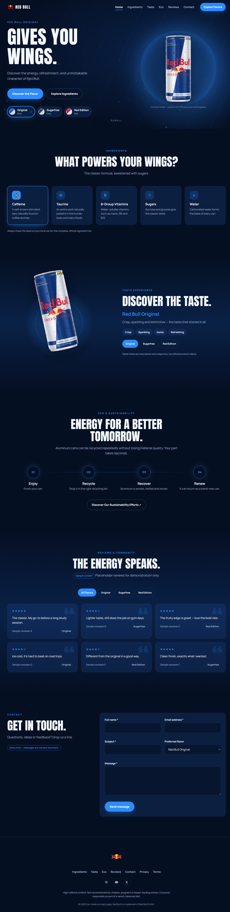
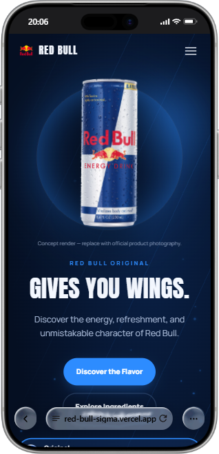

<div align="center">

# ⚡ Red Bull — Choose Your Wings

### A Red Bull-inspired landing page built with HTML, CSS & JavaScript.

[](https://red-bull-sigma.vercel.app/)
[](https://developer.mozilla.org/en-US/docs/Web/HTML)
[](https://developer.mozilla.org/en-US/docs/Web/CSS)
[](https://developer.mozilla.org/en-US/docs/Web/JavaScript)

</div>

---

## 📖 About the Project

**Red Bull — Choose Your Wings** is a product landing page concept inspired by Red Bull's energetic brand identity. The goal is to present a product through an engaging web experience, combining bold visual design, product-focused content, and interactive elements in a page designed for desktop and mobile screens.

Built with **vanilla HTML, CSS, and JavaScript**, this project is also a practical frontend exercise in page structure, visual styling, client-side interactions, and responsive design.

> This is an independent frontend concept for learning and portfolio purposes. It is not an official Red Bull website.

---

## 🌐 Live Demo

**[Visit the website on Vercel](https://red-bull-sigma.vercel.app/)**

---

## 📸 Screenshots

### 💻 Desktop Version

<p align="center">
  
</p>

### 📱 Mobile Version

<p align="center">
  
</p>

> Explore the Red Bull landing page on both desktop and mobile, with immersive visuals, bold typography, dynamic effects, and a responsive layout designed to deliver an engaging and seamless experience across all screen sizes.

---

## ✨ Features

- ⚡ Bold, product-focused landing page
- 🎨 Red Bull-inspired colours, typography, and visual effects
- 🥤 Product presentation and promotional design
- 🖱️ Interactive elements powered by JavaScript
- 📱 Layout designed with desktop and mobile screens in mind
- 💻 Lightweight implementation using core frontend technologies

*Adjust this list to match the exact features in your source code.*

---

## 🛠 Built With

| Technology | Purpose |
|---|---|
| HTML5 | Page structure and content |
| CSS3 | Layout, typography, colours, effects, and responsive styling |
| JavaScript | Client-side interactions |
| Git & GitHub | Version control and source hosting |
| Vercel | Live deployment |

---

## 📂 Project Structure

```text
Red-Bull-Landing-Page/
├── assets/                 # Images and other assets
|    └── screenshots/
│       ├── desktop.png     # Desktop preview
│       └── mobile.png      # Mobile preview
├── javascipt/
|   └── script.js           # JavaScript
├── style/
|   └── styles.css          # Main stylesheet
├── index.html              # Main page
└── README.md               # Readme file
```

> The project is organized into folders and files, each serving a specific purpose to keep the code clean, structured, and easy to navigate.

---

## 🚀 Run the Project Locally

### 1. Install Git

If Git is not installed, get it from [git-scm.com](https://git-scm.com/).

### 2. Clone the repository

```bash
git clone https://github.com/ahmed200-em/red-bull-project
```

### 3. Enter the project folder

```bash
cd red-bull-project
```

Use the actual folder name created by Git if it is different.

### 4. Open the page

- **Quick option:** open `index.html` directly in your browser.
- **Recommended for development:** open the folder in Visual Studio Code and use the **Live Server** extension.

This plain HTML/CSS/JavaScript project normally does not require `npm install` or a build step.

---

## 👀 Just Want to View It?

Open the [Vercel live demo](https://red-bull-sigma.vercel.app/). You don't need to clone or install anything just to browse the website.

---

## 🎯 Project Goals

- Practise building a landing page with core frontend technologies.
- Explore visual hierarchy, product presentation, typography, and colour.
- Make the experience work across desktop and mobile viewports.
- Deploy a project online and document how others can run it locally.

---

## 👨‍💻 Author

**Ahmed Elmakrini**

- GitHub: [@ahmed200-em](https://github.com/ahmed200-em)
- Portfolio: [Visit my portfolio](https://modern-portfolio-93c7xd0ub-ahmed200-ems-projects.vercel.app/)

---

## ⚠️ Trademark & Assets

Red Bull, its logos, and product names are trademarks of their respective owners. This independent project is not affiliated with, sponsored by, or endorsed by Red Bull. Make sure you have permission to redistribute any third-party images, fonts, or brand assets used in the project.

---

<div align="center">

Made with ⚡ using HTML, CSS & JavaScript

</div>
